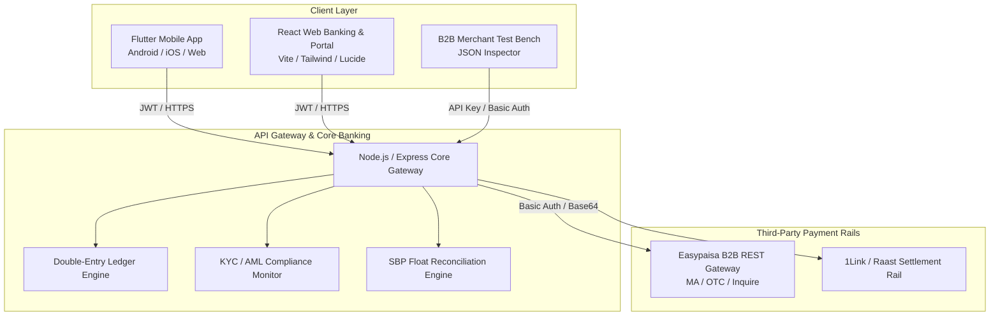

# 🏦 Sherry Bank — Enterprise Digital Banking & Payment Ecosystem

[](https://flutter.dev)
[](https://nodejs.org)
[](https://expressjs.com)
[](https://react.dev)
[](https://vitejs.dev)
[](#)

An enterprise-grade, SBP EMI-compliant digital banking ecosystem and multi-rail payment gateway architecture inspired by Easypaisa, JazzCash, and SadaPay. Built with high security, double-entry financial ledger accounting, real-time settlement reconciliation, and an ultra-luxurious emerald/obsidian/gold fintech UI.

---

## 🏛️ Ecosystem Architecture



---

## 📦 Monorepo Structure

| Module | Directory | Technology | Description |
|---|---|---|---|
| **Core Gateway & Backend** | [`sherry_bank_backend/`](./sherry_bank_backend) | Node.js, Express, Axios, CORS | Core banking ledger, Easypaisa REST B2B proxy, SBP reconciliation, wallet management, and admin backoffice APIs. |
| **Mobile Banking App** | [`sherry_bank_app/`](./sherry_bank_app) | Flutter, Dart, Google Fonts, SVG | Native mobile banking application with custom obsidian/emerald theme, 4-digit MPIN dialer, biometric authentication, dynamic balance card, and transaction ledger. |
| **Web Banking & Merchant Portal** | [`sherry_bank_web/`](./sherry_bank_web) | React, Vite, Lucide, Axios | Consumer landing portal, 3D interactive virtual debit card, B2B merchant test bench (MA/OTC/Inquiry with live JSON response preview), and SBP operations dashboard. |

---

## ⚡ Key Features

### 1. Payment Rails & Easypaisa Integration
- **Mobile Account (MA) Flow**: Direct real-time debiting of mobile wallets via Easypaisa B2B endpoints (`/initiate-ma-transaction`).
- **Over-The-Counter (OTC) Flow**: Tokenized voucher and bill payment generation (`/initiate-otc-transaction`) for cash deposit at physical agents.
- **Transaction Inquiry**: Real-time polling and status verification (`/inquire-transaction`) with idempotency protection.
- **Double-Entry Financial Ledger**: Guarantees zero phantom balances by enforcing equal debits and credits across all customer and escrow accounts.
- **SBP Float Reconciliation**: Daily automated reconciliation checks against regulatory custodial bank accounts.

### 2. Flutter Mobile Application
- **Custom Design System**: Obsidian `#0A0E17`, Emerald `#00D09C`, Gold `#E5A93C` palette.
- **Security**: Custom in-app 4-digit MPIN pad with randomizing haptic feedback & biometric unlock simulation.
- **Responsive Layout**: Optimized for both compact screens and large displays with auto-scaling balance counters.
- **Interactive Sheets**: Modal bottom sheets for instant peer-to-peer transfers and Easypaisa deposits.

### 3. Web & Merchant Operations Portal
- **Interactive 3D Virtual Card**: Dynamic CVV toggling, flip animation, copy account number, and tier badges.
- **Merchant Developer Test Bench**: Live playground for testing Easypaisa B2B API requests with real-time response payload inspector.
- **SBP Compliance Backoffice**: Real-time view of custodial accounts, pending AML flags, and dispute resolution workflows.

---

## 🚀 Quick Start Guide

### Prerequisites
- [Node.js](https://nodejs.org/) (v18+)
- [Flutter SDK](https://docs.flutter.dev/get-started/install) (v3.24+)
- [Git](https://git-scm.com/)

---

### 1. Backend Service Setup
```bash
cd sherry_bank_backend
npm install

# Copy environment template and configure credentials
cp .env.example .env

# Start backend server
npm start
# Server runs at http://localhost:5000
```

Verify backend health:
```bash
curl http://localhost:5000/api/health
```

---

### 2. Flutter Mobile App Setup
```bash
cd sherry_bank_app
flutter pub get

# Run on connected device, emulator, or Chrome
flutter run -d chrome
# or for Android
flutter run -d android
```

---

### 3. Web Portal Setup
```bash
cd sherry_bank_web
npm install

# Start development server
npm run dev
# Portal runs at http://localhost:5173
```

---

## 🛡️ Security & SBP Compliance Standards

- **Zero Hardcoded Secrets**: Production credentials and API keys are injected strictly via environment variables.
- **Data Protection**: Sensitive payload fields (MPIN, CVV, Passwords) are sanitized and stripped from logging pipelines.
- **Anti-Money Laundering (AML)**: Dynamic transaction volume monitoring with automatic escalation for Tier 0/1 KYC thresholds.

---

## 📄 License
Proprietary & Confidential. Developed for Sherry Bank ecosystem.

